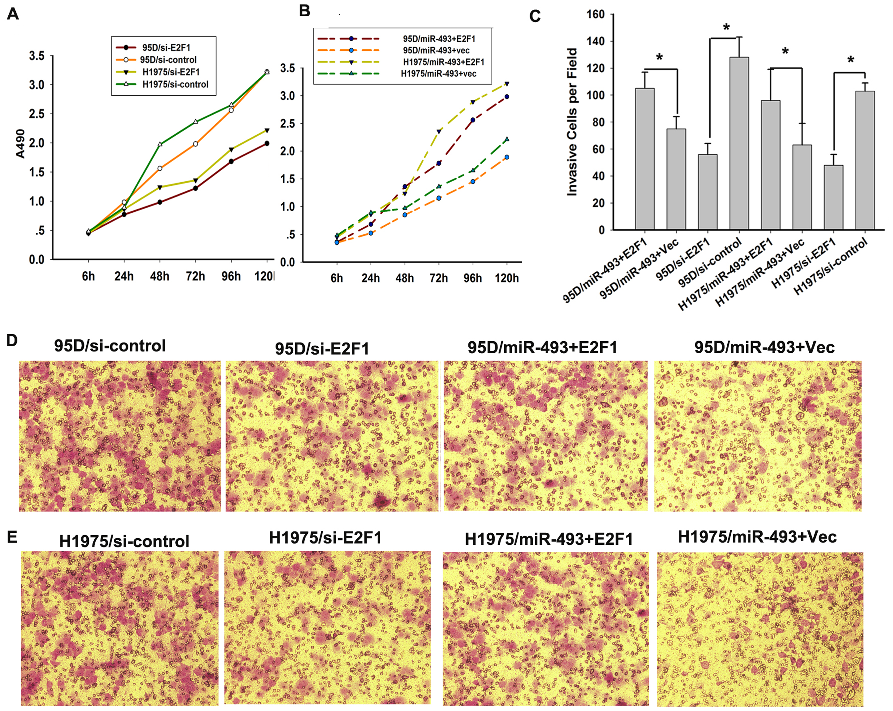
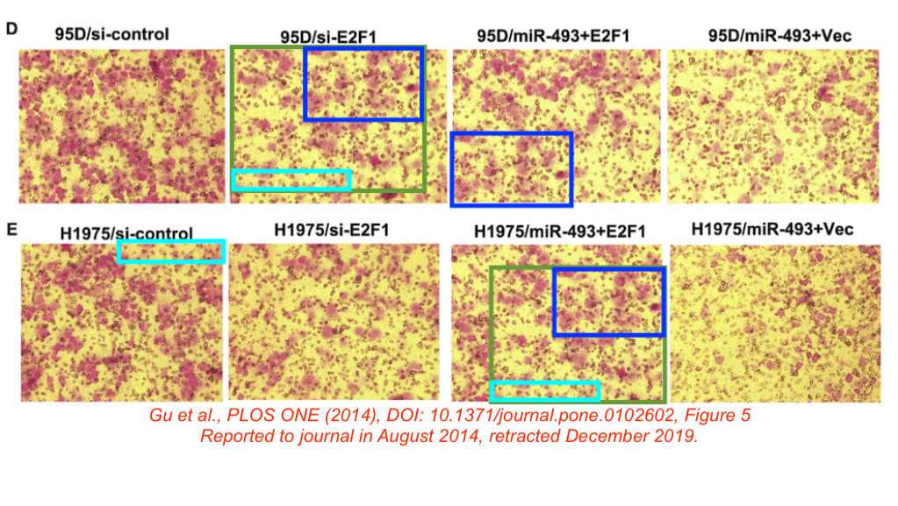
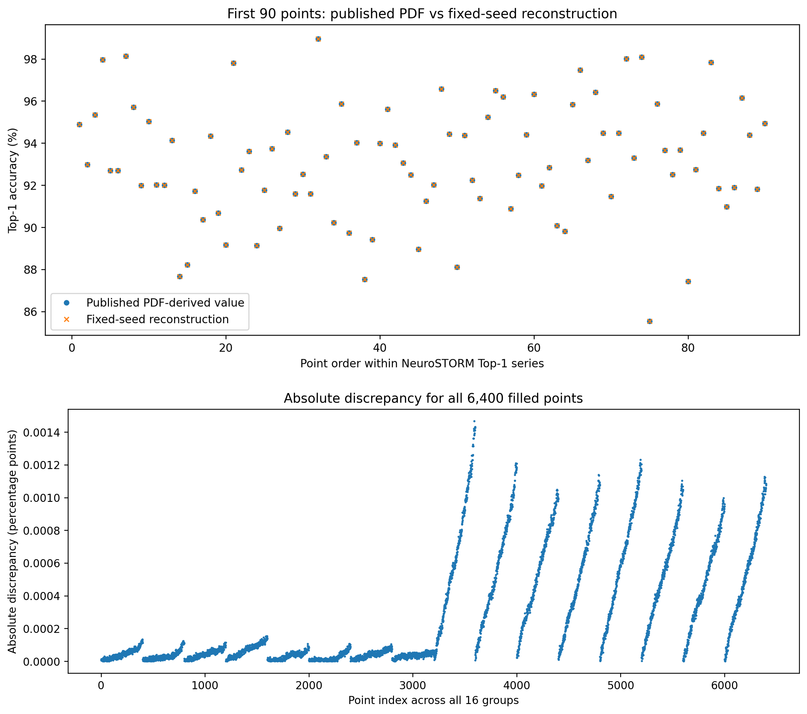

```{r}
#| label: setup
#| echo: false
library(tidyverse)

# defaults
set_theme(theme_bw(base_size = 16))
```


## The Good, the Bad, and the Ugly

- Hopefully, most science is good
- Some is bad
- Some is ugly - the spawn of fabricated or falsified data

How can be recognise such data?

# Forensic data analysis


## Image duplication {.scrollable}

```{r}
#| echo: false

```

::: aside
https://doi.org/10.1371/journal.pone.0102602
:::

---

```{r}
#| echo: false

```

::: notes
Elisabeth Bik has amazing eyes

The Prevalence of Inappropriate Image Duplication in Biomedical Research Publications (2016)

https://doi.org/10.1128/mbio.00809-16

-  3.8% of published papers contained problematic figures

-  at least half of these exhibiting features suggestive of deliberate manipulation.


tools: https://scienceintegritydigest.com/frequently-asked-questions/
:::


## Benford's law

What is the distribution of the first digit of a set of numbers?

. . .

- Might expect a uniform distribution

- Ones most abundant (30%), nines least (5%)

$$P(D_1 = d_1) = log_{10}\left(1 + \frac{1}{d_1}\right); (d _1  = 1, 2, 3, ..., 9)$$

- Expected when data spans several orders of magnitude

- Unexpected deviations from Benford's distribution **may** indicate questionable data.

---

```{r}
library(benford.analysis)
data(corporate.payment) #gets data
cp <- benford(corporate.payment$Amount, sign="both") #generates benford object
```


```{r}
#| label: plot-benford
#| echo: false
ggplot(cp$bfd, aes(x = digits, y = data.dist.freq)) +
  geom_col() +
  geom_line(aes(y = benford.dist.freq), colour = "red", linetype = "dashed", linewidth = 1.5) +
  scale_x_continuous(breaks = seq(0, 100, 10), expand = c(0.02, 0)) +
  labs(x = "Digits", y = "Frequency")

chisq(cp) #gets the Chi-squared test

```

## Terminal digits

What is the distribution of the final digits

. . .

- extension of Benford's law
- Distribution becomes more even for second and subsequent digits
- Digits at the end of the distribution should have a uniform distribution
- Unexpected deviations from expected distributions **may** indicate fake data.

---

```{r}
library(terminaldigits)
td_tests(decoy, weight, decimals = 2, group = subject, reps = 1000) |> 
  arrange(p_value_uniformity_fdr)
decoy |> 
  mutate(terminal = round(weight * 10) %% 10) |> 
  ggplot(aes(x = terminal)) +
  geom_bar() +
  scale_x_continuous(breaks = 0:9) +
  labs(x = "Terminal digit", y = "Count") 
```


## Data duplication

Would you be surprised to find

- duplicated data
- data duplicated with an offset
- data duplicated with a multiplier

Surprisingly common way to falsify data. Pruitt did this repeatedly.

`detectduplicate` can find it

---
```{r}
# remotes::install_github("richardjtelford/detectduplicate")
library(detectduplicate)

data(kp2014)
dup_find(
  x = kp2014$`Theridion murarium Aggressiveness...4`,
  type = "offset"
)
```


## Brown and Heathers' methods

'Data thugs'

> 20 subjects were tested, 94% of them...

GRIM test identifies impossible proportions

## Identify the random seed

Would you be suspicious if you could re-create the data perfectly with `rnorm` after `set.seed(42)`?

```{r}
#| echo: false

```

## Excel formula

Who would ever know if I switched some rows in an excel spreadsheet?

calcChain.xml would know!

[Clusterfake](https://datacolada.org/109)


## Summary

Faking realistic data is surprisingly hard.

Data publication mandates help expose problems.

There are many papers with fake data.

New tools required

Plot everything

Remember they may be an innocent explanation

